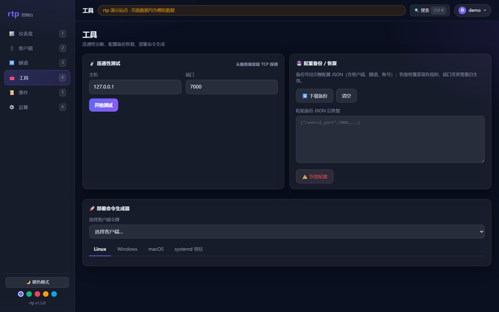
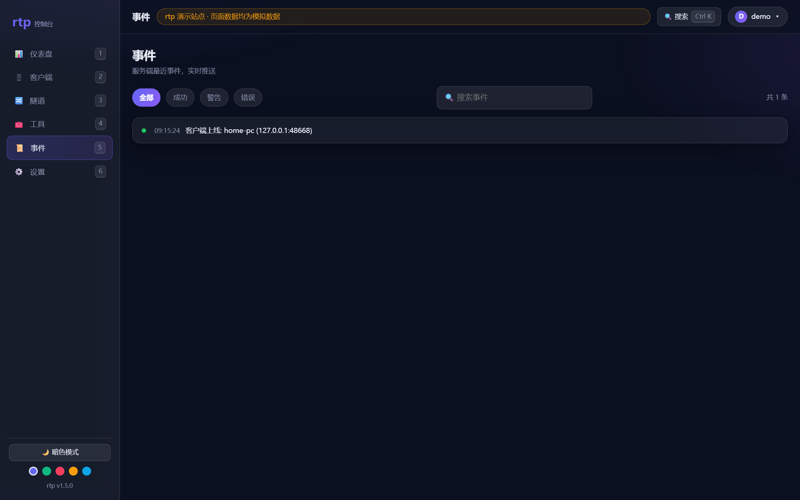

# rtp — Reverse Tunnel Proxy

> 参考 **frp / nps** 设计思路自研的内网穿透工具。Go 编写，**零第三方依赖**（纯 Go 标准库），前后端单文件交付。
>
> 服务端 `rtps`（对应 frps）· 客户端 `rtpc`（对应 frpc / npc）

📖 **完整使用文档（服务端 + 客户端操作手册）见 [使用文档.md](./使用文档.md)** —— 含部署、systemd、防火墙、6 类隧道实战、三平台开机自启、故障排查、API 速查。

---

## ✨ 特性

### 核心能力
- **Web 控制台**：图形化完成客户端管理 / 隧道增删改 / 流量统计 / 限速 / 事件日志 / 客户端下载，**不需要手写任何配置文件**。
- **客户端零配置**：连接后服务端通过控制连接**热推送**隧道规则，增删改隧道不用重启客户端。
- **多客户端模型**：每个客户端独立 token、独立隧道归属、独立在线状态与限速。
- **5 种隧道协议**：TCP、UDP、HTTP（域名/子域名虚拟主机）、HTTPS（SNI 透传）、STCP（密钥访问）。
- **P2P 直连**：两个客户端之间 UDP NAT 打洞直接通信，流量不经服务器中转；打洞失败自动回退服务器中转（类似 frp xtcp，带完整穿透状态可视化）。
- **隧道可视化编辑与热重载**：每条隧道、每个客户端均可点击进入编辑弹窗；改公网端口自动重建监听、改 P2P 配置自动重新打洞，配置即时热推送，无需重启任何进程。
- **自定义令牌**：新建/编辑客户端可指定自定义接入令牌（8-64 位，防重复校验）；管理员令牌可在设置页随时更换（需密码验证，旧令牌立即失效）。

### 控制台体验
- **实时仪表盘**：SSE 推送 + 原生 canvas 自绘带宽曲线，秒级刷新，**无任何外部 CDN 依赖**（内网/离线环境也能用）。
- **流量时序统计**：累计值 + 每分钟流量桶，支持 Top 5 排行。
- **现代化 UI**：玻璃拟态 / 渐变 / 暗·亮主题 / 5 套配色，命令面板（Ctrl+K）、数字键快捷键、搜索过滤、全站元素可点击跳转。
- **账号密码 + 令牌双鉴权**：sha256 加盐哈希 + HttpOnly 会话 cookie（7 天）；也支持令牌直达。
- **内置工具箱**：服务端连通性测试（TCP 探测 + 延迟）、配置备份/恢复（JSON 导入导出）、部署命令生成器（Linux/Windows/macOS/systemd 常驻，自动带令牌）。
- **一键下载客户端**：控制台直接下载 Windows / Linux / macOS 单文件客户端。
- **公告栏**：登录页与控制台顶部展示自定义公告。

## 📸 控制台预览

> 以下截图来自[演示实例](#-快速开始)（模拟数据），暗色主题；另有 4 套浅色/彩色配色可在「设置」切换。

| 仪表盘 · 实时带宽曲线 | 隧道管理 · 6 种协议 |
|---|---|
|  |  |

| 客户端 · 独立令牌/限速 | 隧道向导 · 场景化创建 |
|---|---|
|  |  |

| 隧道编辑 · 可视化热重载 | 工具箱 · 诊断/备份/部署命令 |
|---|---|
|  |  |

| 登录 · 账号密码/令牌双鉴权 | 事件流 · 分级筛选 |
|---|---|
|  |  |

## 🏗️ 架构

```
 外网用户 ──┐
            ├─► 云服务器(rtps) :公网端口 ── 工作连接 ──► rtpc ──► 内网服务
 控制台浏览器 ┘        ▲                                   ▲
                       └──── 控制连接(长连接, 服务端推送规则) ┘
```

- **控制连接**（默认 7000）：客户端鉴权后保持长连接；服务端随时把隧道变更、连接请求（`new_conn`）推给客户端。
- **工作连接**（默认 7001）：服务端收到公网请求后，经控制连接通知客户端「回连工作端口」，再双向透传。
- **Web 控制台**（默认 8080）：REST API + SSE 实时推送 + 内嵌 SPA。
- **P2P 信令**（默认 7002/UDP）：交换双方候选地址协助 NAT 打洞；打洞失败回退服务器中转。
- **UDP / STCP**：UDP 用每条隧道一条长中继连接转发数据报；STCP 要求访问方先发送 `secret:` 行对暗号。

## 🚀 快速开始

### 1. 编译（或在 [Releases](../../releases) 直接下载全平台二进制）

```bash
git clone https://github.com/Liu670/rtp.git && cd rtp

# 服务端
go build -o rtps ./cmd/rtps

# 客户端（当前平台）
go build -o rtpc ./cmd/rtpc

# 交叉编译
GOOS=windows GOARCH=amd64 go build -o rtpc.exe        ./cmd/rtpc
GOOS=darwin  GOARCH=amd64 go build -o rtpc-darwin     ./cmd/rtpc
GOOS=linux   GOARCH=amd64 go build -o rtps-linux      ./cmd/rtps
```

要求 Go 1.21+，无任何第三方依赖。

### 2. 启动服务端（云服务器）

```bash
./rtps -config /etc/rtp.json
# 或直接运行（默认生成 config.json，打印随机管理员令牌）
./rtps
```

放行防火墙：`7000/tcp`（控制）、`7001/tcp`（工作）、`8080/tcp`（Web）、`7002/udp`（P2P 信令），以及隧道公网端口。

### 3. 打开控制台，创建客户端与隧道

浏览器打开 `http://<服务器IP>:8080/`：

- **账号密码登录**：默认 `admin` / `admin123`（首次登录后请立即修改）。
- **令牌直达**：`http://<服务器IP>:8080/?token=<管理员令牌>`。
- 「客户端」页新建客户端 → 复制连接命令（自动带上令牌）。
- 「隧道」页用向导创建：远程桌面(RDP) / SSH / Web / HTTPS / 游戏 UDP / 游戏 TCP / P2P 直连 / 自定义。

### 4. 内网机器运行客户端

```bash
rtpc -server <服务器IP>:7000 -token <客户端token> -name home-pc
```

3 秒自动重连，配置由服务端热推送。之后从任意网络访问 `<服务器IP>:<公网端口>` 即可到达内网服务。

> ⚠️ 流量默认经云服务器中转，云服务器带宽即速度上限；对延迟/带宽敏感的场景请用 **P2P 直连**。

## 🛠️ 隧道类型速查

| 协议 | 场景 | 关键字段 |
|---|---|---|
| `tcp` | RDP / SSH / 任意 TCP 服务 | `public_port`（填 0 = 自动分配空闲端口）、`local_host`/`local_port` |
| `udp` | 游戏 / 语音 / QUIC | 同 tcp |
| `http` | Web 站点（按域名/子域名路由） | `domain` 或 `subdomain`（需先在设置里配 Base Domain） |
| `https` | Web + TLS（SNI 透传） | 同 http |
| `stcp` | 私密访问（先对暗号） | `secret` 访问密钥 |
| `p2p` | 两端直连，不经服务器中转 | 服务方客户端、访问方客户端、访问方本地监听端口 |

### P2P 直连原理

服务端只做 **NAT 打洞信令**（交换双方 UDP 候选地址），数据在两端之间直接传输，承载于自研可靠流 **RUDP**（序号 + 确认 + 重传 + 按流多路复用）。打洞失败自动回退服务器中转。控制台实时显示穿透状态：等待候选 → 打洞中 → **直连** / 服务器中转。

## ⚙️ 配置参考（/etc/rtp.json）

```json
{
  "admin_token": "改成自己的强随机串",
  "control_port": 7000,
  "work_port": 7001,
  "web_port": 8080,
  "p2p_port": 7002,
  "admin_user": "admin",
  "clients":   [ { "id": "...", "name": "home-pc", "token": "...", "bw_limit_mbps": 0 } ],
  "tunnels":   [ { "id": "...", "name": "rdp", "proto": "tcp", "local_port": 3389, "public_port": 33890, "enabled": true } ]
}
```

服务端启动参数：`-config`（配置路径，默认 `config.json`）、`-control/-work/-web`（端口覆盖）、`-token`（管理令牌覆盖）。账号密码哈希由服务端自动管理并在界面修改。全部字段说明见[使用文档](./使用文档.md)。

## 📁 目录结构

```
rtp/
├── cmd/
│   ├── rtps/            # 服务端入口（main.go + 服务端实现）
│   │   ├── main.go      # 启动参数与入口
│   │   ├── server.go    # 运行时、控制/工作连接、公网监听、隧道热推送与热重载
│   │   ├── web.go       # Web 控制台后端（REST API + SSE + 客户端下载）
│   │   ├── ui.go        # 原生前端 SPA（无外部依赖）
│   │   ├── auth.go      # 账号密码鉴权、连通性测试、备份/恢复
│   │   └── p2p.go       # 服务端 P2P 协调器（信令/打洞/relay 回退）
│   └── rtpc/            # 客户端入口（main.go + 客户端实现）
│       ├── main.go      # 启动参数与入口
│       ├── client.go    # 控制连接、隧道中继、UDP 转发
│       └── p2pclient.go # 客户端 P2P（UDP 打洞、RUDP 可靠流、访问端监听）
├── internal/
│   └── core/            # 服务端/客户端共享：行协议、结构定义、限速、流量时序、事件日志
├── .github/workflows/   # CI 构建检查 + tag 自动发布 Release
├── assets/screenshots/  # 控制台截图
└── 使用文档.md           # 完整操作手册
```

## 🔒 安全提示

- 控制/工作通道未加密（明文传输）。敏感场景建议服务端前置 TLS（反代）或仅在内网使用。
- 首次登录后请立即修改默认密码 `admin/admin123`；管理令牌请改成强随机串（设置页可直接更换）。
- 不要把 RDP/SSH 裸奔到公网：用强随机 token + 非常规端口，敏感服务用 `stcp` 密钥访问。
- 「客户端下载」接口需要有效鉴权（token 或登录会话）且有文件名白名单，防止目录穿越。

## 🆚 与 frp / nps 的对比

| 能力 | rtp | frp | nps |
|---|---|---|---|
| Web 控制台配置 | ✅ 全功能可视化 | ⚠️ 仪表盘为主，配置靠文件 | ✅ |
| 客户端零配置（热推送） | ✅ | ❌ 需写配置文件 | ⚠️ 部分支持 |
| P2P 直连 | ✅ 带穿透状态可视化 | ✅ xtcp | ✅ |
| 多客户端独立 token | ✅ | ⚠️ | ✅ vkey |
| 第三方依赖 | **0** | 少量 | 较多 |
| 隧道在线编辑热重载 | ✅ | ⚠️ reload | ⚠️ |

## 📄 License

[MIT](./LICENSE)
