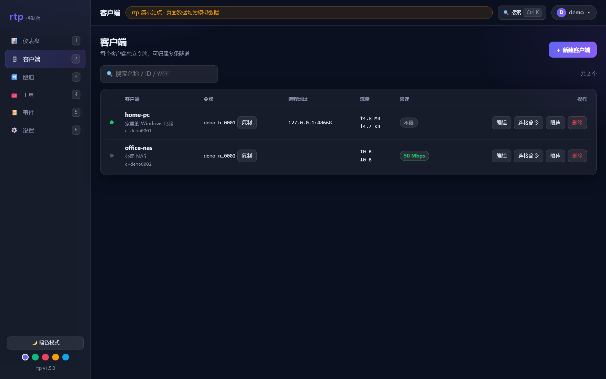
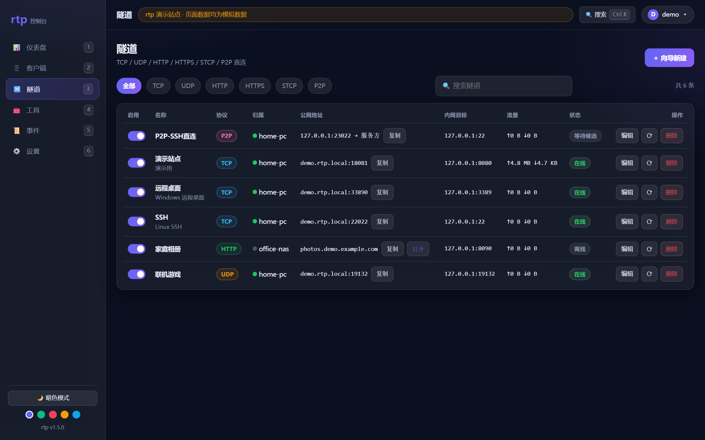
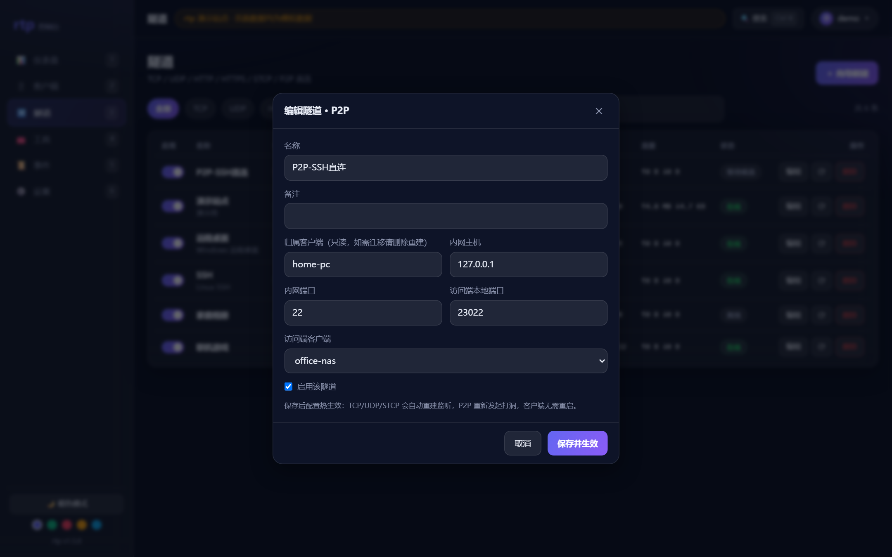
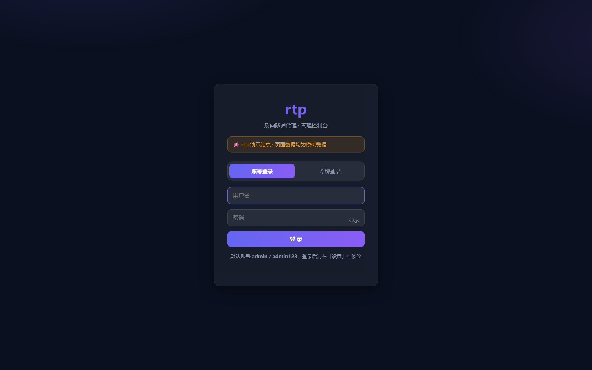
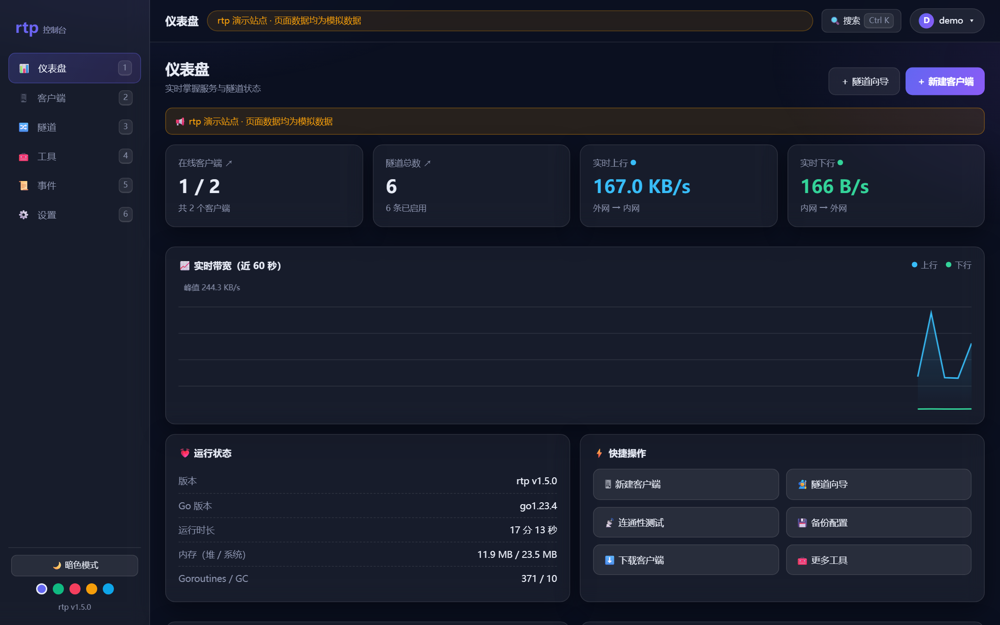

# rtp 使用文档（服务端 + 客户端）

> 版本：v1.0　适用：`rtps`（服务端）/ `rtpc`（客户端，含 Windows/macOS/Linux）　最后更新：2026-10-19
>
> 本文是面向使用者的操作手册。设计与原理请见 [README.md](./README.md)。

---

## 目录

1. [5 分钟上手](#1-5-分钟上手)
2. [概念与端口](#2-概念与端口)
3. [服务端篇](#3-服务端篇)
   - [3.1 环境与文件](#31-环境与文件)
   - [3.2 命令行参数](#32-命令行参数)
   - [3.3 配置文件详解](#33-配置文件详解)
   - [3.4 启动与 systemd 托管](#34-启动与-systemd-托管)
   - [3.5 防火墙放行](#35-防火墙放行)
   - [3.6 首次登录与安全加固](#36-首次登录与安全加固)
   - [3.7 升级 / 备份 / 迁移](#37-升级--备份--迁移)
4. [客户端篇](#4-客户端篇)
   - [4.1 下载与运行](#41-下载与运行)
   - [4.2 命令行参数](#42-命令行参数)
   - [4.3 Windows 后台常驻与开机自启](#43-windows-后台常驻与开机自启)
   - [4.4 Linux 常驻（systemd）](#44-linux-常驻systemd)
   - [4.5 macOS 常驻](#45-macos-常驻)
   - [4.6 多设备管理](#46-多设备管理)
5. [隧道类型实战](#5-隧道类型实战)
   - [5.1 TCP（RDP / SSH / 数据库）](#51-tcprdp--ssh--数据库)
   - [5.2 UDP（游戏 / 语音）](#52-udp游戏--语音)
   - [5.3 HTTP 虚拟主机](#53-http-虚拟主机)
   - [5.4 HTTPS（SNI 透传）](#54-httpssni-透传)
   - [5.5 STCP（密钥握手）](#55-stcp密钥握手)
   - [5.6 P2P 直连](#56-p2p-直连)
6. [Web 控制台使用](#6-web-控制台使用)
7. [常见问题排查](#7-常见问题排查)
8. [安全建议](#8-安全建议)
9. [附录：API 速查](#9-附录api-速查)

---

## 1. 5 分钟上手

假设服务端已部署在 `203.0.113.10`（本文示例地址，换成你自己的即可）。

**第 1 步：登录控制台**

浏览器打开 `http://203.0.113.10:8080/`，用账号 `admin` / `admin123` 登录（或访问 `http://203.0.113.10:8080/?token=<管理员令牌>` 直达）。

> 首次登录后请立刻到「设置 → 账号安全」修改密码。

**第 2 步：新建客户端**

「客户端」页 → 「+ 新建客户端」→ 填名称（如 `home-pc`）→ 保存后复制该客户端的 **令牌** 和 **连接命令**。

**第 3 步：在要被访问的内网电脑上运行客户端**

```
rtpc.exe -server 203.0.113.10:7000 -token <第2步的客户端令牌> -name home-pc
```

看到 `[client] 已连接...` 即接入成功。

**第 4 步：建隧道**

「隧道」页 → 「+ 新建隧道」→ 向导选「远程桌面(RDP)」（或手动填：协议 `tcp`、内网 `127.0.0.1:3389`、公网端口 `33890`）→ 保存。

**第 5 步：访问**

在任意能上网的电脑上，远程桌面连接 `203.0.113.10:33890`，即可操作家里电脑。

> 公网端口需要在云厂商防火墙放行（见 3.5）。填 `0` 表示自动分配一个空闲端口。

---

## 2. 概念与端口

### 2.1 三个角色

| 角色 | 程序 | 说明 |
|---|---|---|
| 服务端 | `rtps` | 部署在有公网 IP 的云服务器，负责监听公网端口、转发流量、提供 Web 控制台 |
| 客户端 | `rtpc` | 部署在要被访问的内网机器，主动连出（无需公网 IP、无需路由器端口映射） |
| 访问者 | 任意工具 | 通过「云服务器:公网端口」访问内网服务（RDP 客户端、浏览器、SSH…） |

### 2.2 服务端端口

| 端口 | 协议 | 用途 | 是否必须放行 |
|---|---|---|---|
| `7000` | TCP | 控制连接（客户端长连接，接收规则推送） | ✅ 必须 |
| `7001` | TCP | 工作连接（客户端回连，承载实际流量） | ✅ 必须 |
| `8080` | TCP | Web 控制台 | ✅ 必须（或自行改端口） |
| `7002` | UDP | P2P 信令（NAT 打洞协调） | 用 P2P 时放行 |
| `80` / `443` | TCP | HTTP / HTTPS 虚拟主机（需在配置里显式开启） | 用 HTTP(S) 隧道时放行 |
| 自定义 | TCP/UDP | 每条 TCP/UDP/STCP 隧道的公网端口 | 按需放行 |

> 服务端所有监听都是 `:端口`（全接口），不区分网卡。

### 2.3 数据流（非 P2P）

```
访问者 → 云服务器:公网端口 → rtps ──(工作连接)──→ rtpc → 内网服务
```

带宽上限 = 云服务器带宽。若想省服务器带宽，用 **P2P**（见 5.6）。

---

## 3. 服务端篇

### 3.1 环境与文件

- 系统：Linux（Ubuntu 20.04+/Debian 11+/CentOS 7+ 均可），amd64 或 arm64
- 依赖：**无**。`rtps` 是静态单文件（Go 编译，零第三方库），不需要数据库、不需要运行时
- 推荐目录：

```
/usr/local/bin/rtps        # 二进制
/etc/rtp.json              # 配置文件
/tmp/rtps.log              # 日志（系统重启会清空，可按 3.4 改路径）
```

检查是否已在运行：

```bash
systemctl status rtp-server
```

### 3.2 命令行参数

```bash
rtps [-config 配置文件] [-control 端口] [-work 端口] [-web 端口] [-token 管理员令牌]
```

| 参数 | 默认值 | 说明 |
|---|---|---|
| `-config` | `config.json` | 配置文件路径。**首次运行会自动生成**（内含随机管理员令牌） |
| `-control` | `7000` | 控制端口，覆盖配置文件 |
| `-work` | `7001` | 工作端口，覆盖配置文件 |
| `-web` | `8080` | Web 控制台端口，覆盖配置文件 |
| `-token` | 空 | 管理员令牌，覆盖配置文件并**写回**配置文件 |

示例：

```bash
rtps -config /etc/rtp.json
```

> 注意：`-token` 的值会持久化到配置文件，不是临时覆盖。想临时改端口用 `-control/-work/-web`（这三个不会写回）。

### 3.3 配置文件详解

完整示例（`/etc/rtp.json`）：

```json
{
  "admin_token": "你的管理员令牌",
  "control_port": 7000,
  "work_port": 7001,
  "web_port": 8080,
  "http_port": 0,
  "https_port": 0,
  "p2p_port": 7002,
  "base_domain": "",
  "admin_user": "admin",
  "admin_salt": "a1b2c3d4e5f60718",
  "admin_pass_hash": "……（sha256 十六进制）",
  "announcement": "",
  "clients": [
    {
      "id": "c-1a2b3c4d",
      "name": "home-pc",
      "token": "5f2e……（64 位十六进制）",
      "note": "家里台式机",
      "created_at": 1760000000,
      "bw_limit_mbps": 0
    }
  ],
  "tunnels": [
    {
      "id": "t-9f8e7d6c",
      "name": "远程桌面(RDP)",
      "proto": "tcp",
      "client_id": "c-1a2b3c4d",
      "local_host": "127.0.0.1",
      "local_port": 3389,
      "public_port": 33890,
      "domain": "",
      "subdomain": "",
      "secret": "",
      "enabled": true,
      "note": "",
      "visitor_client_id": "",
      "visitor_port": 0
    }
  ]
}
```

**顶层字段**

| 字段 | 类型 | 说明 |
|---|---|---|
| `admin_token` | string | 管理员令牌（Web 令牌登录 + `default` 客户端连接用） |
| `control_port` | int | 控制端口，默认 7000 |
| `work_port` | int | 工作端口，默认 7001 |
| `web_port` | int | Web 控制台端口，默认 8080 |
| `http_port` | int | HTTP 虚拟主机监听端口，`0` = 不启用（常用 `80`） |
| `https_port` | int | HTTPS（SNI 透传）端口，`0` = 不启用（常用 `443`） |
| `p2p_port` | int | P2P 信令 UDP 端口，默认 `control_port + 2` |
| `base_domain` | string | 根域名，用于 HTTP/HTTPS 子域名路由，如 `example.com` |
| `admin_user` | string | 控制台账号，默认 `admin` |
| `admin_salt` | string | 密码盐（随机 16 位） |
| `admin_pass_hash` | string | `sha256(salt + 密码)` 的十六进制 |
| `announcement` | string | 公告，展示在登录页与控制台顶部 |
| `clients[]` | array | 客户端列表 |
| `tunnels[]` | array | 隧道列表 |

**客户端字段（clients[]）**

| 字段 | 说明 |
|---|---|
| `id` | 客户端 ID，`c-` 开头，自动生成 |
| `name` | 显示名称 |
| `token` | 该客户端的接入令牌（64 位随机十六进制） |
| `note` | 备注 |
| `created_at` | 创建时间（Unix 秒） |
| `bw_limit_mbps` | 带宽上限（Mbps），`0` = 不限速；上下行**共用**该配额 |

**隧道字段（tunnels[]）**

| 字段 | 说明 |
|---|---|
| `id` | 隧道 ID，`t-` 开头 |
| `name` | 隧道名称 |
| `proto` | `tcp` / `udp` / `http` / `https` / `stcp` / `p2p` |
| `client_id` | 归属客户端（`p2p` 时指**服务方**） |
| `local_host` | 内网目标地址，通常 `127.0.0.1` |
| `local_port` | 内网目标端口 |
| `public_port` | 公网端口（tcp/udp/stcp 用），`0` = 自动分配 |
| `domain` | 完整域名（http/https 用，优先于 subdomain） |
| `subdomain` | 子域名前缀，配合 `base_domain` 拼成 `子域名.根域名` |
| `secret` | STCP 握手密钥 |
| `enabled` | 是否启用（关闭后端口不再监听） |
| `note` | 备注 |
| `visitor_client_id` | P2P 的**访问方**客户端 ID |
| `visitor_port` | P2P 访问方本机监听端口 |

> **哪些改动需要重启？**
> 端口、账号密码哈希、`admin_token` 改配置文件后需重启；`base_domain`、公告、客户端、隧道在控制台改动后**立即生效**（隧道启停会真正 listen/close）。

### 3.4 启动与 systemd 托管

**前台试跑**（排查问题用）：

```bash
/usr/local/bin/rtps -config /etc/rtp.json
```

看到类似输出即成功：

```
管理员 token: xxxxxxxx
控制端口: 7000  工作端口: 7001  Web端口: 8080
[control] 监听 :7000
[work] 监听 :7001
[p2p] 信令监听 :7002
```

**注册为 systemd 服务**（推荐）：

```bash
sudo tee /etc/systemd/system/rtp-server.service >/dev/null <<'EOF'
[Unit]
Description=rtp reverse tunnel server
After=network-online.target
Wants=network-online.target

[Service]
Type=simple
ExecStart=/usr/local/bin/rtps -config /etc/rtp.json
Restart=always
RestartSec=3
StandardOutput=append:/tmp/rtps.log
StandardError=append:/tmp/rtps.log

[Install]
WantedBy=multi-user.target
EOF

sudo systemctl daemon-reload
sudo systemctl enable --now rtp-server
```

**常用运维命令**

```bash
systemctl status rtp-server        # 状态
systemctl restart rtp-server       # 重启（换二进制后必须）
systemctl stop rtp-server          # 停止
journalctl -u rtp-server -n 50     # 若未重定向日志，看这里
tail -f /tmp/rtps.log              # 当前 unit 的日志位置
```

**替换二进制**（升级时）：

```bash
# 正在运行的二进制不能直接覆盖（Text file busy），先删再拷
rm -f /usr/local/bin/rtps
cp ./rtps /usr/local/bin/rtps
chmod +x /usr/local/bin/rtps
systemctl restart rtp-server
```

### 3.5 防火墙放行

需要放行两层：**云厂商安全组/防火墙** + **系统防火墙**。

腾讯云轻量应用服务器：控制台 → 实例 → 防火墙 → 添加规则（TCP 7000、7001、8080；UDP 7002；隧道公网端口如 33890）。

系统内（若启用了 ufw / firewalld）：

```bash
# ufw
ufw allow 7000/tcp
ufw allow 7001/tcp
ufw allow 8080/tcp
ufw allow 7002/udp
ufw allow 33890/tcp      # 示例隧道端口

# firewalld
firewall-cmd --permanent --add-port=7000-7001/tcp
firewall-cmd --permanent --add-port=8080/tcp
firewall-cmd --permanent --add-port=7002/udp
firewall-cmd --permanent --add-port=33890/tcp
firewall-cmd --reload
```

> 隧道建好后如果连不上，**八成是公网端口没放行**。

### 3.6 首次登录与安全加固

1. 浏览器打开 `http://<公网IP>:8080/`，用 `admin` / `admin123` 登录。
2. 「设置 → 账号安全」修改用户名和密码（需输入当前密码，弱密码会被拒绝）。
3. 可选：把 `admin_token` 换成自己的强随机串（改 `/etc/rtp.json` 的 `admin_token` 后重启），或启动时用 `-token`。
4. 「设置」里填写 `base_domain`、公告等。

**忘记密码怎么办？**

停服务 → 编辑 `/etc/rtp.json`，把 `admin_user`、`admin_salt`、`admin_pass_hash` 三个字段删除（或置为空字符串）→ 启动服务。服务端检测到为空会自动恢复默认 `admin` / `admin123`，随后立即重新设置。

```bash
systemctl stop rtp-server
# 编辑 /etc/rtp.json，删除上面三个字段
systemctl start rtp-server
```

### 3.7 升级 / 备份 / 迁移

**备份**：控制台「工具 → 配置备份 → 下载 JSON」，或直接复制 `/etc/rtp.json`。建议改完配置就备份一次。

**恢复**：控制台「工具 → 配置恢复」粘贴 JSON → 一键还原。注意：

- 恢复会覆盖 `admin_token` 与账号密码，**当前登录会话会失效**，需要用备份里的密码重新登录；
- 端口类变更需重启服务生效。

**迁移到新服务器**：

1. 拷 `rtps` 二进制 + `/etc/rtp.json`；
2. 新机器按 3.4 建 systemd unit；
3. 放行同样端口；
4. 把域名的 A 记录指向新 IP；
5. 客户端 `-server` 改成新 IP（或在 DNS 用域名，换 IP 时客户端无需改）。

---

## 4. 客户端篇

### 4.1 下载与运行

**下载渠道**（三选一）：

1. GitHub [Releases](https://github.com/Liu670/rtp/releases) 下载全平台预编译二进制；
2. 控制台「设置 → 客户端下载」，直接下载 `Windows(.exe)` / `Linux` / `macOS`；
3. 命令行下载（把 token 换成你的）：
   ```bash
   curl -O "http://203.0.113.10:8080/api/download?name=rtpc.exe&token=你的管理员令牌"
   ```
   可用文件名：`rtpc.exe`、`rtpc-linux`、`rtpc-darwin`
4. 源码自行编译（见 README，`go build -o rtpc ./cmd/rtpc`）。



*控制台客户端页：在线状态、令牌复制、连接命令、限速*

**Linux / macOS 首次运行**：

```bash
chmod +x rtpc-linux
./rtpc-linux -server 203.0.113.10:7000 -token <客户端令牌> -name home-pc
```

**Windows**：双击 `rtpc.exe` 会一闪而过（需要参数），请用命令行或按 4.3 做后台常驻。

正常输出：

```
[client] 已连接，工作端口=7001，P2P 信令端口=7002，等待服务端推送隧道规则
[client] 同步到 2 条隧道
```

### 4.2 命令行参数

```bash
rtpc -server <主机[:端口]> -token <客户端令牌> -name <名称>
```

| 参数 | 默认值 | 说明 |
|---|---|---|
| `-server` | `127.0.0.1:7000` | 服务端地址。可只写 IP/域名，端口默认 7000 |
| `-token` | 无（**必填**） | 客户端令牌，在控制台「客户端」页新建后获得 |
| `-name` | `home-pc` | 客户端显示名（仅用于日志，可与控制台名称不同） |

行为说明：

- 客户端**不需要配置文件**，隧道规则全部由服务端推送；
- 断线后 **每 3 秒自动重连**，无需人工干预；
- 控制台增删隧道、启停隧道，客户端**无需重启**即时生效；
- `Ctrl+C` 或关闭窗口即停止。

> **令牌怎么选？** 每个设备在控制台「客户端」页建一个独立客户端、用各自令牌，便于单独统计/限速/删除。直接用管理员令牌也能连（会归到 `default` 客户端），但不建议多设备共用。
>
> **自定义令牌**：新建客户端时「接入令牌」可留空（自动生成），也可填 8-64 位自定义令牌（字母/数字/`-`/`_`，不能与其他客户端或管理员令牌重复），方便记忆与脚本化管理。已在运行的客户端也支持「编辑 → 更换令牌」，旧令牌在该客户端下次重连后失效。

**编辑客户端**：客户端页点击名称（或「编辑」按钮）可修改名称、备注、限速、更换令牌，保存即生效。

### 4.3 Windows 后台常驻与开机自启

客户端是控制台程序，关掉窗口就断开。以下三种方式任选。

**方式 A：启动文件夹 + 最小化批处理（最简单）**

新建 `C:\rtp\start-rtpc.bat`：

```bat
@echo off
start "" /min "C:\rtp\rtpc.exe" -server 203.0.113.10:7000 -token 你的客户端令牌 -name home-pc
```

按 `Win+R` 输入 `shell:startup`，把该 bat 的**快捷方式**放进去，登录 Windows 后自动在最小化窗口运行。

**方式 B：任务计划程序（更稳，可隐藏窗口）**

1. 任务计划程序 → 创建任务；
2. 常规：勾选「不管用户是否登录都要运行」+「使用最高权限运行」；
3. 触发器：新建 → 「登录时」；
4. 操作：启动程序 `C:\rtp\rtpc.exe`，参数
   `-server 203.0.113.10:7000 -token 你的令牌 -name home-pc`；
5. 设置：勾选「如果任务失败，按以下频率重新启动」，间隔 1 分钟。

**方式 C：nssm 注册为 Windows 服务（推荐长期使用）**

```bat
nssm install rtp-client "C:\rtp\rtpc.exe"
nssm set rtp-client AppParameters "-server 203.0.113.10:7000 -token 你的令牌 -name home-pc"
nssm set rtp-client Start SERVICE_AUTO_START
nssm start rtp-client
```

之后可在「服务」管理器里启停，开机自启、崩溃自动拉起。

> 提示：Windows 防火墙一般不影响客户端（它是主动连出），无需放行入站。

### 4.4 Linux 常驻（systemd）

```bash
sudo cp rtpc-linux /usr/local/bin/rtpc
sudo chmod +x /usr/local/bin/rtpc

sudo tee /etc/systemd/system/rtp-client.service >/dev/null <<'EOF'
[Unit]
Description=rtp tunnel client
After=network-online.target
Wants=network-online.target

[Service]
Type=simple
ExecStart=/usr/local/bin/rtpc -server 203.0.113.10:7000 -token 你的客户端令牌 -name office-nas
Restart=always
RestartSec=3

[Install]
WantedBy=multi-user.target
EOF

sudo systemctl daemon-reload
sudo systemctl enable --now rtp-client
systemctl status rtp-client
journalctl -u rtp-client -f          # 看日志
```

常用于 NAS、树莓派、公司内网 Linux 主机。

### 4.5 macOS 常驻

**临时后台运行**：

```bash
chmod +x rtpc-darwin
nohup ./rtpc-darwin -server 203.0.113.10:7000 -token 你的令牌 -name my-mac > /tmp/rtpc.log 2>&1 &
```

**开机自启（launchd）**：新建 `~/Library/LaunchAgents/com.rtp.client.plist`：

```xml
<?xml version="1.0" encoding="UTF-8"?>
<!DOCTYPE plist PUBLIC "-//Apple//DTD PLIST 1.0//EN"
 "http://www.apple.com/DTDs/PropertyList-1.0.dtd">
<plist version="1.0">
<dict>
  <key>Label</key><string>com.rtp.client</string>
  <key>ProgramArguments</key>
  <array>
    <string>/usr/local/bin/rtpc-darwin</string>
    <string>-server</string><string>203.0.113.10:7000</string>
    <string>-token</string><string>你的令牌</string>
    <string>-name</string><string>my-mac</string>
  </array>
  <key>RunAtLoad</key><true/>
  <key>KeepAlive</key><true/>
  <key>StandardOutPath</key><string>/tmp/rtpc.log</string>
  <key>StandardErrorPath</key><string>/tmp/rtpc.log</string>
</dict>
</plist>
```

```bash
launchctl load ~/Library/LaunchAgents/com.rtp.client.plist
```

> 首次运行若提示「无法验证开发者」：系统设置 → 隐私与安全性 → 仍要打开；或执行 `xattr -d com.apple.quarantine ./rtpc-darwin`。

### 4.6 多设备管理

每台设备一个客户端，互不干扰：

| 设备 | 控制台客户端 | 运行命令 |
|---|---|---|
| 家里台式机 | `home-pc` | `rtpc -server IP:7000 -token <A> -name home-pc` |
| 公司笔记本 | `office-laptop` | `rtpc -server IP:7000 -token <B> -name office-laptop` |
| 群晖 NAS | `nas` | `rtpc -server IP:7000 -token <C> -name nas` |

好处：可以在「客户端」页分别看在线状态、流量、单独限速、单独删除（删除会级联删除其隧道）。

### 4.7 手机端（Android / Termux）

rtp 提供 **Android (arm64) 版客户端**，在 [Termux](https://termux.dev/) 中直接运行，无需 root。适合两种场景：

- **手机做访问端**：出门时用手机 SSH/RDP/HTTP 访问家里的服务（配合 P2P 隧道）；
- **手机做被控端**：把手机上的服务（如 Termux 里跑的 Web）暴露出去。

**使用步骤**

1. 安装 [Termux](https://f-droid.org/packages/com.termux/)（F-Droid 或 GitHub 版本，Google Play 版过旧不建议）；
2. 下载客户端（三种方式任选）：
   - **手机扫码直接下载**（Android arm64，v1.1.0）：

   

   - 控制台「设置 → 客户端下载 → 📱 Android」一键下载；
   - GitHub Releases 页面下载 `rtpc-android-arm64`。
3. 传到手机后，在 Termux 中执行：

```bash
# 允许执行（下载目录示例，按实际路径调整）
chmod +x ~/Download/rtpc-android-arm64
mv ~/Download/rtpc-android-arm64 ~/rtpc
# 运行（令牌从控制台客户端页复制）
~/rtpc -server 43.142.62.24:7000 -token <令牌> -name my-phone
```

4. 保持 Termux 在后台（系统设置里对 Termux 关闭电池优化、加白名单），客户端即可常驻。

**手机端常用命令**

```bash
# 前台运行看日志
~/rtpc -server IP:7000 -token <令牌> -name my-phone
# Termux 后台常驻 + 开机自启（需 termux-services 或 nohup）
nohup ~/rtpc -server IP:7000 -token <令牌> -name my-phone >/dev/null 2>&1 &
#  wake-lock 防止休眠断连
termux-wake-lock
```

**注意事项**

- 仅提供 arm64 版本（覆盖 2017 年后的主流手机；32 位旧机型可用 x86_64 模拟器或自行交叉编译）；
- iOS 系统不允许运行第三方命令行程序，暂不支持；可用「访问端放电脑/安卓机 + 手机浏览器直接访问 HTTP 隧道」的方式变相实现；
- P2P 直连在移动网络（运营商 NAT）下成功率低于家用宽带，打洞失败会自动回退服务器中转，功能不受影响；
- 手机做被控端时，注意隧道填的本地端口是 Termux 里的服务端口（如 `127.0.0.1:8080`）。

---

## 5. 隧道类型实战



*隧道列表：协议筛选、启停开关、点击名称编辑、⟳ 重载、复制公网地址*


*隧道向导：按场景一键填好常用参数*

所有隧道都在控制台「隧道 → + 新建隧道」创建。向导里选预设最省事，也可以用「自定义」。

### 5.0 隧道编辑与热重载

- 隧道列表里**点击隧道名称**（或「编辑」按钮）打开编辑弹窗，可改名称、备注、内网主机/端口、公网端口、域名/子域名、STCP 密钥、P2P 访问端等全部字段，以及启用开关。
- **保存即热生效**，无需重启服务端或客户端：
  - `tcp` / `udp` / `stcp`：公网端口变化时自动**重建监听**（旧端口立即关闭、新端口立即打开）；
  - `p2p`：自动**重新发起打洞**；
  - `http` / `https`：路由即时更新；
  - 新配置会**热推送**到在线客户端（`sync`），客户端无需重启。
- 行内 **⟳ 重载** 按钮可强制重建监听 / 重新打洞（排查端口状态异常时有用）。
- 公网端口冲突会在保存时被拦截并提示。



*编辑弹窗：全部字段可视化修改，保存即热生效*

### 5.1 TCP（RDP / SSH / 数据库）

**场景**：把内网任意 TCP 服务映射到公网端口。

| 配置项 | RDP 示例 | SSH 示例 | MySQL 示例 |
|---|---|---|---|
| 协议 | `tcp` | `tcp` | `tcp` |
| 内网主机 | `127.0.0.1` | `127.0.0.1` | `127.0.0.1` |
| 内网端口 | `3389` | `22` | `3306` |
| 公网端口 | `33890` | `22022` | `33306` |

**访问方式**：

```bash
# RDP：远程桌面连接 203.0.113.10:33890
ssh -p 22022 user@203.0.113.10
mysql -h 203.0.113.10 -P 33306 -u root -p
```

**要点**：

- Windows 需先开启「远程桌面」；Linux 需装 `openssh-server`；
- 数据库、SSH 暴露公网风险高，务必用强密码/密钥，并考虑用非常规端口；
- 公网端口填 `0` 让系统自动分配（保存后会显示实际端口），避免手动找空闲端口；
- 新端口记得在云防火墙放行。

### 5.2 UDP（游戏 / 语音）

**场景**：Minecraft 基岩版、CS、语音服务器、自研 UDP 服务。

| 配置项 | 值 |
|---|---|
| 协议 | `udp` |
| 内网主机/端口 | 游戏服务实际监听地址，如 `127.0.0.1:19132` |
| 公网端口 | 如 `19132`（UDP） |

**要点**：

- 游戏客户端连接 `203.0.113.10:19132`；
- 云防火墙要放行 **UDP** 端口（不是 TCP）；
- UDP 走服务端中继，延迟取决于云服务器与两端网络。

### 5.3 HTTP 虚拟主机

**场景**：把内网 Web 服务（如 NAS 管理页、开发环境）按域名发布。

**前置条件**：

1. 服务端配置里开启 HTTP 端口（默认关闭）：
   ```json
   "http_port": 80
   ```
   重启服务，并在防火墙放行 80。
2. 「设置」里填根域名，如 `example.com`；
3. DNS 把 `*.example.com`（或具体子域名）A 记录指向 `203.0.113.10`。

**创建隧道**：协议 `http`，内网 `127.0.0.1:5000`，子域名填 `nas`。

**访问**：`http://nas.example.com`

**要点**：

- 路由依据 HTTP `Host` 头，所以必须用域名访问，直接访问 IP 不行；
- 多个 http 隧道可共用 80 端口，靠子域名区分；
- 内网服务若是 HTTPS，用 `https` 隧道而非 `http`。
- 监听 80/443 需要 root 权限；若以普通用户运行，先执行
  `setcap 'cap_net_bind_service=+ep' /usr/local/bin/rtps`，或改用 8081/8443 等高位端口。
- 若服务器上已装 Nginx/Apache 占用了 80/443，请先停用或改它们的端口，避免监听冲突。

### 5.4 HTTPS（SNI 透传）

**场景**：内网服务自己带 TLS 证书，希望原样透传到公网（端到端加密，服务端不解密）。

**配置**：

1. 服务端配置 `"https_port": 443`，重启 + 放行；
2. 建隧道：协议 `https`，内网 `127.0.0.1:443`，子域名 `app`；
3. DNS：`app.example.com` → 服务器 IP。

**访问**：`https://app.example.com`

**要点**：

- 证书由**内网服务自己提供**，服务端只按 ClientHello 的 SNI 转发，不解密、不换证；
- 因此浏览器地址栏域名必须与内网服务证书的域名一致，否则证书告警；
- 与 `http` 隧道可共存于同一域名体系。

### 5.5 STCP（密钥握手）

**场景**：不想让公网任何人碰到端口，访问前必须先「对暗号」。

**配置**：协议 `stcp`，公网端口如 `25000`，`secret` 留空会自动生成（也可自填）。

**访问**：连接后先发一行 `secret:<密钥>\n`，通过校验后即为正常 TCP 流。

```bash
# Linux/macOS 交互式
{ printf 'secret:你的密钥\n'; cat; } | nc 203.0.113.10 25000
```

**要点与限制**：

- 握手是**明文一行文本**，不是加密；它只是「进门口令」，防扫描、防误连；
- 普通客户端软件（RDP、浏览器等）不会自动发送这一行，**因此 STCP 更适合脚本/自研协议**；
- 需要给 RDP/SSH 加保护时，建议用 `tcp` + 非常规公网端口 + 强身份认证，或直接上 P2P。

### 5.6 P2P 直连

**场景**：两台设备之间传大文件、远程桌面，希望**流量不过云服务器**（省带宽、降延迟）。

**原理**：服务端只做信令，帮双方交换 NAT 候选地址；双方 UDP 打洞成功后直连，数据走自研可靠流（RUDP）。打洞失败自动回退服务器中转。

**配置步骤**：

1. 两台设备各建一个客户端并都运行 `rtpc`（保持在线）；
2. 「隧道 → + P2P 直连」：
   - **服务方**：被访问的服务所在客户端（如 `home-pc`）
   - **访问方**：发起访问的客户端（如 `office-laptop`）
   - 内网主机/端口：服务方机器上的目标，如 `127.0.0.1:3389`
   - 访问方本地端口：访问方机器上要监听的端口，如 `23389`
3. 保存后无需重启客户端。

**访问**：在**访问方那台机器**上连接 `127.0.0.1:23389`，即直达服务方内网服务。

**状态含义**（隧道列表徽章）：

| 状态 | 含义 |
|---|---|
| 等待候选 | 双方还没都上报 NAT 地址（通常是对端未在线） |
| 打洞中 | 已交换地址，正在尝试直连（首次需数秒） |
| 直连 | 成功，流量不经服务器 |
| 服务器中转 | 打洞失败，已自动回退（功能可用，但走服务器带宽） |

**要点**：

- 服务端 UDP `7002` 必须放行，否则打洞必失败；
- 双方都需能主动连出 UDP（多数家庭宽带可以）；对称型 NAT / 严格企业防火墙常失败 → 自动回退中转；
- 第一次连接需要几秒打洞，之后建立新连接会快很多；
- 隧道公网端口对 P2P 不适用（P2P 没有公网监听端口）。

---

## 6. Web 控制台使用

地址：`http://<公网IP>:8080/`

**两种登录方式**：

- 账号密码：默认 `admin` / `admin123`，登录后写 HttpOnly cookie，7 天免登录；
- 令牌直达：`http://<IP>:8080/?token=<管理员令牌>`，之后同样写 cookie。



**页面与能力**

| 页面 | 能做什么 |
|---|---|
| 仪表盘 | 在线客户端/隧道数、实时上下行、近 60 秒带宽曲线、运行状态（版本/Go/运行时长/内存/Goroutines/GC）、快捷操作、流量 Top 5、最近事件、端口总览。**统计卡点击跳转对应页面，Top5 点击直达隧道编辑，事件点击查看全部，端口点击跳设置** |
| 客户端 | 新建（令牌可自动生成或**自定义**）、在线状态、一键复制令牌/连接命令、点击名称**编辑**（名称/备注/限速/更换令牌）、限速、删除（级联删隧道）、搜索 |
| 隧道 | 新建（向导：RDP/SSH/Web/HTTPS/游戏 UDP/游戏 TCP/P2P/自定义）、协议筛选、搜索、启停开关、**点击名称编辑（热重载）**、⟳ 重载、复制公网地址、HTTP 隧道直接打开、删除、P2P 状态徽章 |
| 工具 | 连通性测试（服务端发起 TCP 探测，显示延迟与历史）、配置备份（下载 JSON）/恢复（粘贴 JSON）、部署命令生成器（Linux/Windows/macOS/systemd，自动带令牌） |
| 事件 | 按级别（成功/警告/错误）筛选 + 搜索，记录连接/掉线/隧道变更 |
| 设置 | 根域名、公告栏、**通知机器人（Webhook）**、账号安全（改用户名/密码）、**管理令牌更换**（需密码验证，旧 token 链接立即失效）、客户端下载、关于 |



*仪表盘：实时统计卡 + 带宽曲线 + 运行状态 + 快捷操作（全部可点击跳转）*

**快捷键**

| 快捷键 | 作用 |
|---|---|
| `Ctrl/⌘ + K` | 打开命令面板（搜命令、客户端、隧道并直达） |
| `1` ~ `6` | 切换页面 |
| `/` | 聚焦当前页搜索框 |
| `Esc` | 关闭弹窗 / 命令面板 |

**主题**：右上角可切换亮/暗主题与 5 套配色（靛蓝/翠绿/玫红/琥珀/天蓝），偏好保存在浏览器本地。

**实时性**：仪表盘通过 SSE（`/api/stream`）每秒推送一次快照，无需手动刷新。

### 6.1 通知机器人（Webhook）

在「设置 → 🔔 通知机器人」可以配置群机器人推送，客户端上下线、隧道增删改、P2P 穿透、管理操作等事件会即时推送到群里。

**支持的机器人类型**

| 类型 | Webhook 地址格式 |
|---|---|
| 飞书 | `https://open.feishu.cn/open-apis/bot/v2/hit/<token>` |
| 企业微信 | `https://qyapi.weixin.qq.com/cgi-bin/webhook/send?key=<key>` |
| 钉钉 | `https://oapi.dingtalk.com/robot/send?access_token=<token>` |
| 自定义 JSON | 任意接受 `POST` JSON 的地址（收到原始事件结构） |

**获取 Webhook 地址**：
- **飞书**：目标群 → 设置 → 群机器人 → 添加机器人 → 「自定义机器人」→ 复制 Webhook 地址；
- **企业微信**：群聊右键 → 添加群机器人 → 复制 Webhook 地址；
- **钉钉**：群设置 → 智能群助手 → 添加机器人 → 「自定义」→ 复制 Webhook 地址（安全设置任选一种即可）。

**可订阅的事件类型（9 种）**

| 事件 | 含义 |
|---|---|
| 客户端上线 / 客户端下线 | 客户端连接、断开控制连接 |
| 客户端创建 / 客户端修改 | 新建客户端、编辑名称/限速/令牌 |
| 隧道创建 / 隧道修改 / 隧道删除 | 隧道增删改（含向导创建与编辑热重载） |
| P2P 直连 | P2P 穿透启动、回退服务器中转 |
| 管理操作 | 登录、配置恢复、令牌更换等管理动作 |

**配置步骤**：设置页点「＋ 新建通知」→ 选择机器人类型 → 粘贴 Webhook 地址 → 勾选要订阅的事件（可全选）→ 保存。保存后点「🧪 测试」向群里发一条测试消息验证连通性。每条通知可随时启用/停用、编辑或删除，可配置多条机器人分别订阅不同事件。

---

## 7. 常见问题排查

**Q1：客户端启动就退出，日志 `必须通过 -token 指定与管理端一致的 token`**
没传 `-token`。到控制台「客户端」页复制令牌。

**Q2：客户端日志 `认证失败: 令牌无效，请在控制台创建客户端`**
令牌写错，或用了别的客户端的令牌。注意令牌是 64 位字符串，别漏字符。

**Q3：客户端连不上服务端（一直重连）**
依次检查：服务端 `systemctl status rtp-server` 是否 active → 云防火墙是否放行 7000/7001 → `-server` 是否写错 IP/端口 → 本机网络是否能出网（`ping`/`telnet 203.0.113.10 7000`）。

**Q4：隧道建好了，访问公网端口没反应**

1. 该客户端是否**在线**（控制台客户端页绿点）；
2. 公网端口是否在**云防火墙 + 系统防火墙**都放行；
3. 内网服务是否在运行，且监听地址不是仅 `127.0.0.1` 以外的限制（用 `ss -lntp` 确认）；
4. 端口是否被别的隧道占用（控制台会提示；填 `0` 可自动分配）。

**Q5：提示「公网端口 xxx 已被占用」**
换一个端口，或公网端口填 `0` 让系统自动选空闲端口。

**Q6：HTTP 隧道访问 404 / 打不开**

- 服务端 `http_port` 是否为 `0`（未启用）→ 配置里改成 80 并重启；
- 「设置 → 根域名」是否填了；
- DNS 是否把子域名解析到服务器 IP（`nslookup nas.example.com`）；
- 访问时是否用了域名（不能直接用 IP 访问虚拟主机）。

**Q7：控制台打不开**
8080 是否放行；服务是否 active；`curl -I http://127.0.0.1:8080/` 在服务器本机试；若服务器改过 `web_port`，用新端口。

**Q8：P2P 一直显示「打洞中」或「等待候选」**

- 双方客户端是否都在线；
- 服务端 UDP `7002` 是否放行；
- 企业网络/对称 NAT 可能打不通，等待自动回退「服务器中转」；
- 打洞期间先别急着连，等状态变成「直连」再访问。

**Q9：忘记控制台密码**
见 3.6：停服后删除 `admin_user`/`admin_salt`/`admin_pass_hash` 三字段，重启恢复默认。

**Q10：改了配置不生效**
端口/密码/令牌类改动需 `systemctl restart rtp-server`；隧道、客户端、公告、根域名是热生效的。

**Q11：换服务器后客户端连不上**
客户端 `-server` 里若写的是 IP，需要逐台改；建议用域名（A 记录指向服务器），换 IP 只改 DNS。

**Q12：想看服务端日志**
当前 unit 输出到 `/tmp/rtps.log`（`tail -f /tmp/rtps.log`）；若你的 unit 没有重定向，用 `journalctl -u rtp-server -f`。

**Q13：速度慢**
非 P2P 模式速度上限就是云服务器带宽（常见 5~10 Mbps 峰值）；大流量场景用 P2P，或升级服务器带宽。也可在客户端页给单设备限速，避免一个设备占满。

---

## 8. 安全建议

1. **先改默认密码**：`admin/admin123` 只用于首次登录，务必立即修改。
2. **控制台不要裸奔**：8080 建议限制来源 IP（云防火墙白名单），或改非常规端口；有条件前面挂 Nginx + HTTPS。
3. **一设备一令牌**：不要多设备共用令牌，便于单独吊销（删除客户端即失效）。
4. **通道未加密**：控制/工作通道目前是明文（服务端可见流量）。传敏感数据请叠加应用层加密（HTTPS、SSH、数据库 TLS）。
5. **少暴露高危端口**：RDP/SSH/数据库尽量用非常规公网端口 + 强认证；能走 P2P 就别走公网端口。
6. **STCP 不是加密**：握手口令是明文行，只防误连，不防窃听。
7. **定期备份配置**：「工具 → 配置备份」，改完配置就备份。
8. **关注公告栏**：可在控制台发布维护通知给所有使用者。

---

## 9. 附录：API 速查

所有接口除 `/api/login` 外均需鉴权：`?token=<管理员令牌>`、请求头 `X-Token`、或登录会话 cookie。

| 方法 | 路径 | 说明 |
|---|---|---|
| POST | `/api/login` | 账号密码登录 `{username,password}`，写会话 cookie |
| POST | `/api/logout` | 退出登录 |
| GET | `/api/me` | 当前身份、公告、是否默认密码 |
| GET | `/api/overview` | 概览（客户端/隧道/流量/端口） |
| GET | `/api/stream` | SSE 实时快照（每秒） |
| GET/POST | `/api/clients` | 客户端列表 / 新建 `{name, token?}`（token 可自定义） |
| DELETE/PUT | `/api/clients/{id}` | 删除（级联隧道）/ 编辑 `{name?,note?,bw_limit_mbps?,token?}` |
| GET/POST | `/api/tunnels` | 隧道列表 / 新建（TunnelConfig） |
| DELETE/PUT | `/api/tunnels/{id}` | 删除 / 编辑（全字段指针更新，`public_port` 变化自动重建监听；`reload:true` 强制重载） |
| GET | `/api/traffic` | 流量时序（隧道/客户端） |
| GET | `/api/events` | 事件日志 |
| POST | `/api/wizard` | 向导式建隧道 `{preset,...}` |
| GET/PUT | `/api/settings` | 读取 / 修改根域名、公告、账号密码 |
| GET | `/api/client_cmd` | 生成客户端连接命令 |
| GET | `/api/download?name=rtpc.exe` | 下载客户端（白名单） |
| GET | `/api/stats` | 运行状态（uptime/内存/goroutine/GC） |
| POST | `/api/probe` | 连通性测试 `{host,port}` |
| GET | `/api/backup` | 导出配置 JSON |
| POST | `/api/restore` | 导入配置 JSON |

示例：

```bash
TOKEN=你的管理员令牌
curl "http://203.0.113.10:8080/api/overview?token=$TOKEN"

curl -X POST -H "Content-Type: application/json" \
  -d '{"name":"home-pc"}' \
  "http://203.0.113.10:8080/api/clients?token=$TOKEN"

curl -X POST -H "Content-Type: application/json" \
  -d '{"client_id":"c-xxxx","name":"RDP","proto":"tcp","public_port":33890,"local_host":"127.0.0.1","local_port":3389}' \
  "http://203.0.113.10:8080/api/tunnels?token=$TOKEN"
```

---

**相关文档**：[README.md](./README.md)（原理、特性对比、源码结构、编译方式）
